# Closets Closets by Ninkie
### E-commerce Website Development & Systems Implementation

**Project Status:** Completed — October 2026  
**Role:** WordPress & WooCommerce Developer  
**Live Website:** https://closetsclosetsbyninkie.co.za  
**Location:** Cape Town, South Africa

## Project Overview

Closets Closets by Ninkie is a live fashion e-commerce platform developed using WordPress and WooCommerce.

The project involved configuring, integrating, deploying, and testing multiple technologies to create a functional online retail environment supporting product management, secure payments, shipping, inventory control, customer communications, and store administration.

This project demonstrates practical experience in website deployment, IT systems integration, access management, technical configuration, and troubleshooting.

## Technologies Used

| Technology | Purpose |
|---|---|
| WordPress | Content management and website administration |
| WooCommerce | E-commerce functionality and order management |
| Cloudflare | DNS management |
| Paystack | Online payment processing |
| ATUM Inventory Management | Stock and inventory administration |
| Bob Go | Shipping and fulfilment integration |
| PublishPress Capabilities | Role-based access control |
| Rank Math SEO | Search engine optimization |
| Google Search Console | Search performance and indexing monitoring |
| Tidio | Customer communication |
| UpdraftPlus | Website backup management |

## Key Features Implemented

### 1. E-commerce Storefront
- Responsive fashion website
- Product categories and variations
- Product search and navigation
- Shopping cart and checkout functionality

### 2. Payment Integration
- Paystack payment gateway configuration
- Manual EFT payment option
- Checkout and payment workflow testing

### 3. Inventory Management
- ATUM inventory management integration
- Stock quantity tracking
- Variable product inventory configuration

### 4. Shipping and Order Fulfilment
- Bob Go shipping integration
- South African and international delivery configuration
- Free shipping threshold rules
- Order management workflows

### 5. Access Control and Administration
- Configured separate Administrator and Store Owner roles
- Implemented role-based permissions
- Restricted access to sensitive administrative functions

### 6. Website Operations
- Cloudflare DNS configuration
- Transactional email configuration
- Customer communication integration
- Backup management
- SEO configuration and Google Search Console integration

## Testing and Verification

The completed platform underwent functional testing covering:

- Storefront navigation
- Product selection and variations
- Shopping cart and checkout
- Payment processing
- Inventory updates
- Shipping workflows
- User permissions
- Mobile responsiveness
- Administrative operations

## Technical Skills Demonstrated

- WordPress Administration
- WooCommerce Configuration
- E-commerce Systems Integration
- Role-Based Access Control
- DNS Management
- Payment Gateway Integration
- Inventory Management
- Technical Troubleshooting
- Website Deployment and Testing

## Project Outcome

Successfully delivered an operational e-commerce website integrating customer-facing shopping functionality with essential back-office management systems.

The website is live, with ongoing Google Search visibility monitoring and SEO enhancements.

## Live Demonstration

Visit the completed website:

https://closetsclosetsbyninkie.co.za

---

**Portfolio Note:** This repository documents the implementation and configuration of the website. It does not contain the private production WordPress installation, third-party plugin source code, customer records, or sensitive credentials.
## Technical Challenges & Solutions

### Role-Based Access Control
**Challenge:** The Store Owner account initially lacked permissions to add and manage products.

**Solution:** Configured granular permissions using PublishPress Capabilities, separating product, order, and coupon management from sensitive Administrator functions.

### Inventory Management
**Challenge:** Managing stock availability across different product sizes and variations.

**Solution:** Configured WooCommerce variable-product inventory and ATUM stock management, then verified stock behaviour through checkout testing.

### Payment Integration and Testing
**Challenge:** Verifying that online payment transactions and order statuses worked correctly.

**Solution:** Integrated Paystack with WooCommerce, performed a test transaction, and verified the refund workflow.

### Search Engine Visibility
**Challenge:** Troubleshooting sitemap submission and structured-data warnings in Google Search Console.
## Project Screenshots

The following screenshots document the live e-commerce website,
customer shopping experience, checkout process, inventory management,
and role-based access controls.

### Homepage & Storefront

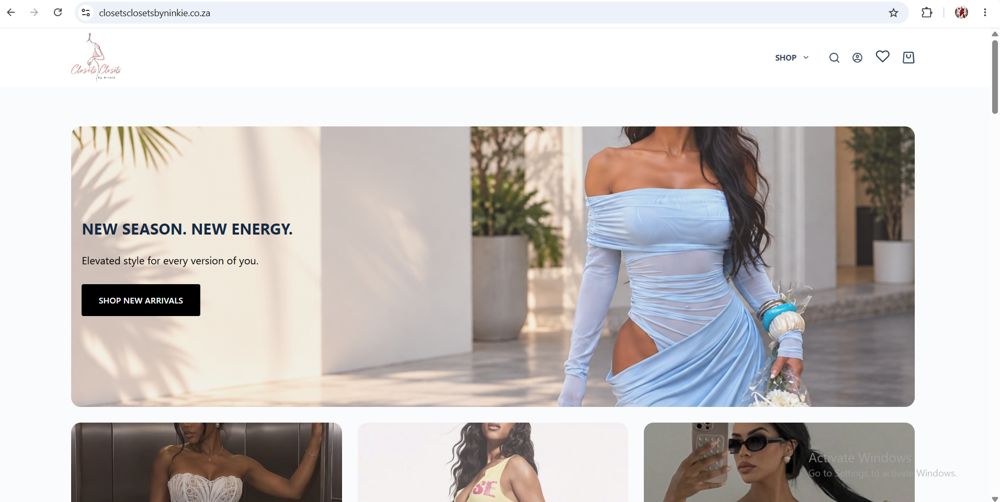

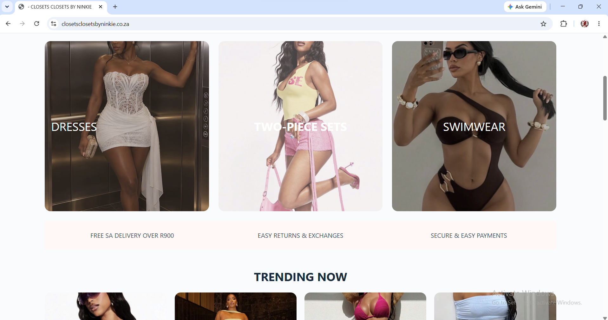

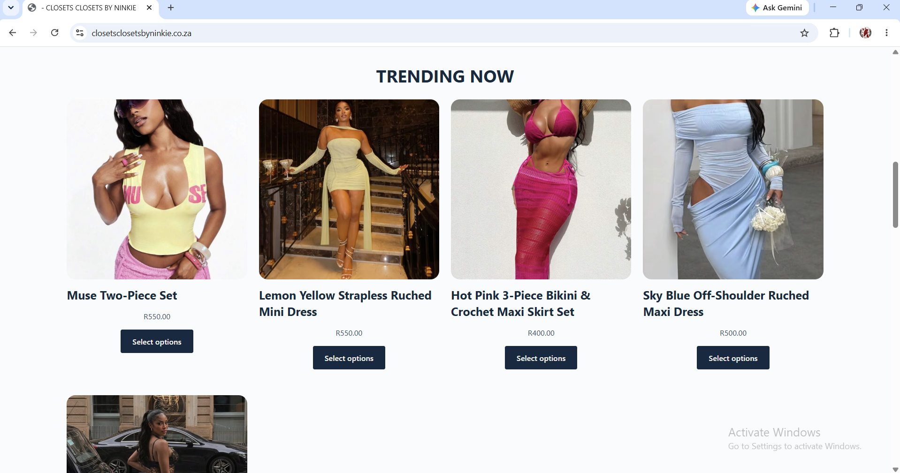

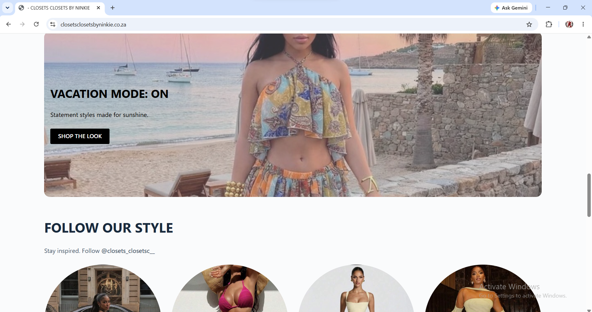

### Customer Engagement

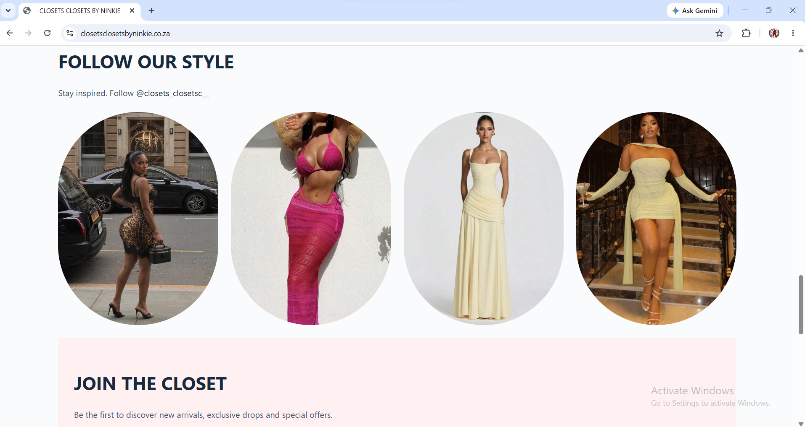

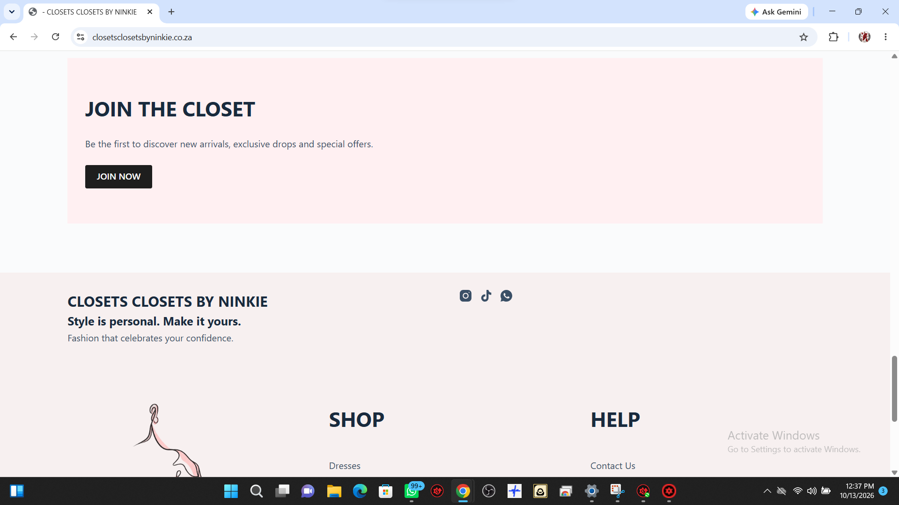

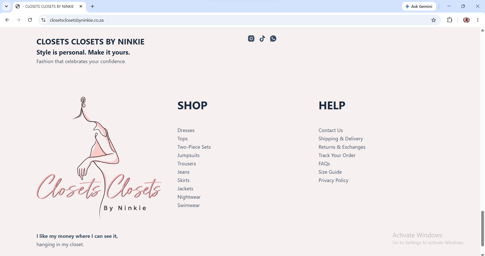

### Product Catalogue & Shopping Experience

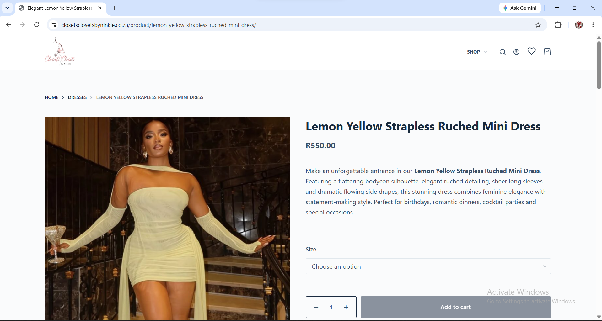

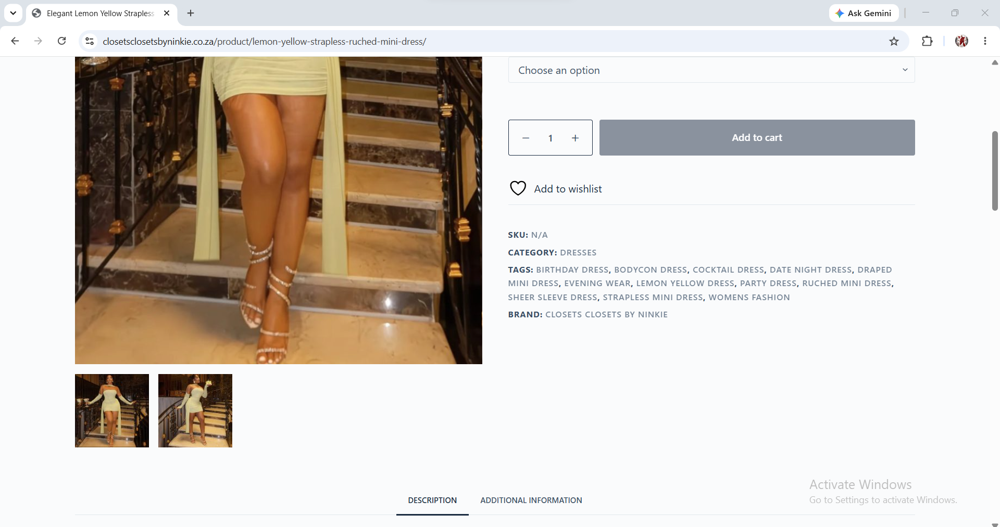

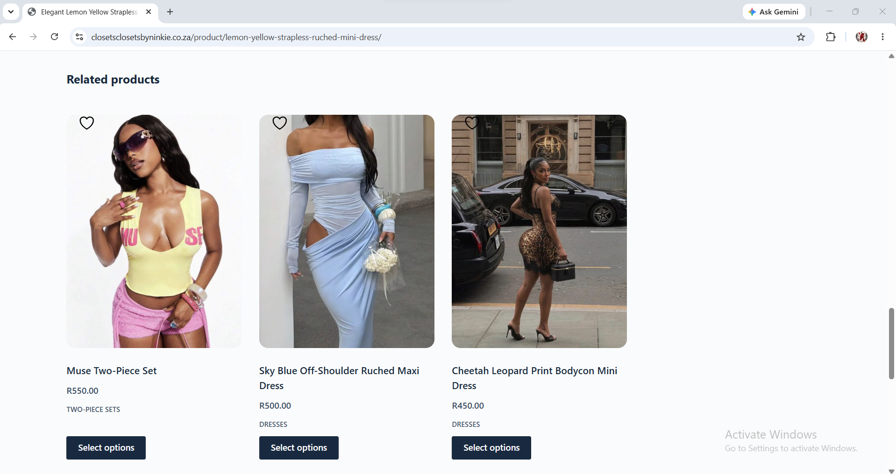

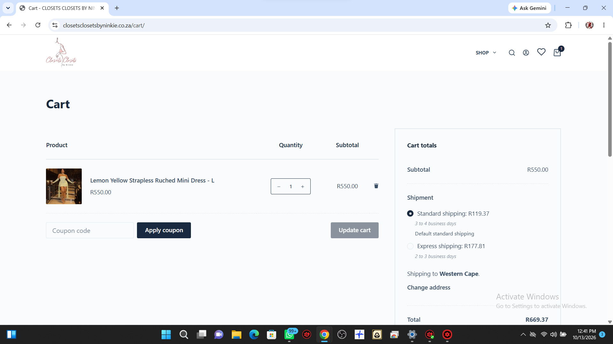

### Checkout & Shipping

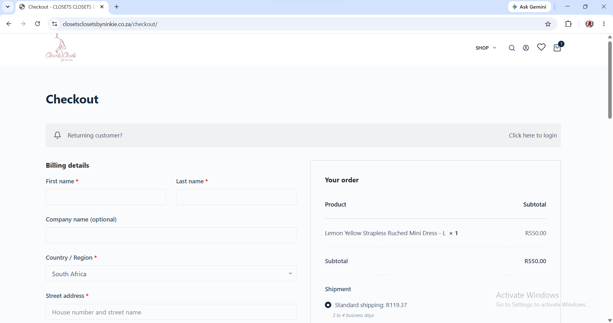

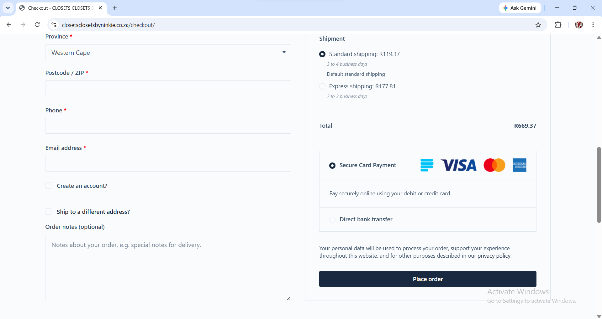

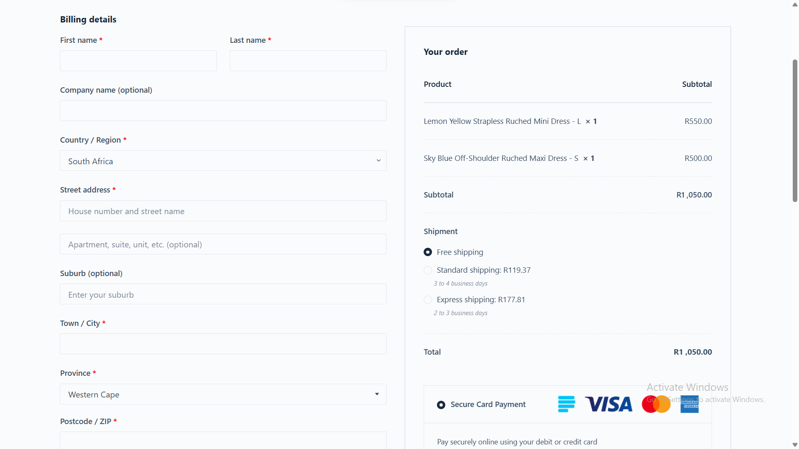

### Store Administration & Access Control

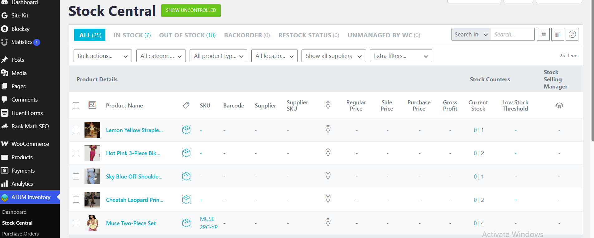

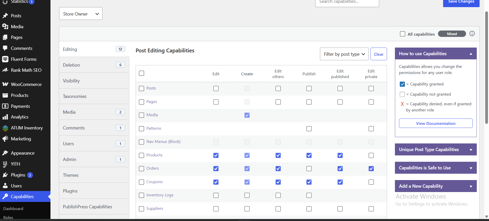
**Solution:** Configured Rank Math SEO, submitted sitemaps, and investigated indexing and structured-data reports. Remaining non-critical SEO improvements are being monitored.
